# Studi Machine Learning pada Dataset Abalone

Tugas Pendamping UTS SK5017 Sains dan Pengamanan Data, Semester 1 2026/2027, Institut Teknologi Bandung.
Nama: Khoiro Amalia  |  NIM: (isi NIM)

Laporan ini membahas tiga paradigma pembelajaran mesin pada satu dataset: klasifikasi jenis kelamin (Bagian 1), regresi jumlah cincin (Bagian 2), dan klasterisasi tak terawasi (Bagian 3). Seluruh angka di bawah dihasilkan langsung oleh kode di repositori ini dengan `random_state = 42`, sehingga dapat direproduksi.

## Struktur repositori

```
common.py                 pemuatan dan pembersihan data
part1_classification.py   Bagian 1 (SVM dan Random Forest)
part2_regression.py       Bagian 2 (regresi)
part3_clustering.py       Bagian 3 (K-means, Spectral, Hierarchical)
data/abalone.data         salinan dataset UCI (tanpa header)
figures/                  semua gambar yang dirujuk laporan
results/                  keluaran numerik (json dan log)
requirements.txt
```

Cara menjalankan: `pip install -r requirements.txt`, lalu `python part1_classification.py`, `python part2_regression.py`, dan `python part3_clustering.py` dari direktori utama repositori.

## 0. Data dan praproses

Dataset Abalone dari UCI *Machine Learning Repository* berisi 4177 pengamatan dengan delapan peubah masukan: satu peubah kategorik `Sex` (M = jantan, F = betina, I = *infant*) dan tujuh peubah numerik, yaitu `Length`, `Diameter`, `Height` (awalnya dalam mm; nilai pada berkas sudah dibagi 200 oleh pengumpul data), serta `Whole_weight`, `Shucked_weight`, `Viscera_weight`, `Shell_weight` (gram). Peubah `Rings` adalah jumlah cincin pada cangkang; umur abalone kira-kira `Rings + 1,5` tahun. Tidak ada nilai kosong dan tidak ada baris duplikat.

Dua baris memiliki `Height = 0`, yang secara fisik tidak mungkin, sehingga kedua baris itu (keduanya berkelas I) dibuang dan tersisa 4175 pengamatan. Satu pengamatan dengan `Height = 1,13` jauh di luar sebaran lainnya (rata-rata sekitar 0,14), tetapi ia tidak mustahil secara fisik. Saya mempertahankannya agar tidak membuang data tanpa dasar yang kuat. Pengaruhnya terlihat sebagai satu titik terpencil pada plot PCA di Bagian 3, dan sumbu plot dipotong agar sebaran utama tetap terbaca.

Peubah numerik saling berkorelasi sangat kuat karena semuanya mengukur ukuran tubuh. Hal ini berdampak pada pembahasan di ketiga bagian: komponen utama pertama saja sudah menjelaskan 90,8% ragam data terstandarisasi, dan faktor inflasi ragam (VIF) beberapa peubah melebihi 40.

Untuk Bagian 1 dan 2, data dibagi menjadi 80% data latih (3340 baris) dan 20% data uji (835 baris) dengan `random_state = 42`. Pada klasifikasi pembagian dilakukan secara berstrata menurut kelas. Standarisasi (`StandardScaler`) selalu dimasukkan ke dalam *pipeline*, sehingga rata-rata dan simpangan baku dihitung hanya dari data latih (dan hanya dari lipatan latih saat validasi silang). Dengan begitu informasi data uji tidak bocor ke dalam model. Seluruh pemilihan hiperparameter memakai validasi silang 5 lipatan pada data latih; data uji hanya dipakai sekali untuk evaluasi akhir.

## 1. Klasifikasi jenis kelamin

### Rancangan

Targetnya adalah `Sex` dengan tiga kelas (F, I, M). Satu catatan tentang instruksi "tangani fitur kategorik": semua fitur masukan di sini sudah numerik, dan satu-satunya peubah kategorik adalah target itu sendiri, yang dikodekan dengan `LabelEncoder` (F = 0, I = 1, M = 2). Peubah `Rings` tidak dipakai sebagai fitur karena soal meminta prediksi dari ukuran fisik. Fitur numerik distandarisasi.

SVM memakai kernel RBF dengan pencarian grid atas `C` ∈ {0,1; 1; 10; 100; 1000} dan `gamma` ∈ {*scale*; 0,001; 0,01; 0,1; 1}. Kombinasi terbaik adalah `C = 100` dan `gamma = 0,1` dengan akurasi validasi silang 0,554. *Random Forest* dicari atas jumlah pohon {200, 500}, kedalaman maksimum {4, 6, 8, tak terbatas}, dan `min_samples_leaf` {1, 5, 10}. Hasil terbaiknya 500 pohon, tanpa batas kedalaman, `min_samples_leaf = 10`, dengan akurasi validasi silang 0,546. Sebagai pembanding disertakan *baseline* yang selalu menebak kelas mayoritas.

### Hasil pada data uji

| Model | Akurasi | Presisi (*macro*) | *Recall* (*macro*) | F1 (*macro*) |
|---|---|---|---|---|
| *Baseline* (kelas mayoritas) | 0,366 | 0,122 | 0,333 | 0,179 |
| SVM (RBF) | 0,564 | 0,569 | 0,559 | 0,533 |
| *Random Forest* | 0,562 | 0,552 | 0,562 | 0,549 |

Nilai per kelas (presisi / *recall*):

| Kelas | SVM | *Random Forest* |
|---|---|---|
| F (betina) | 0,567 / 0,226 | 0,500 / 0,345 |
| I (*infant*) | 0,660 / 0,832 | 0,669 / 0,821 |
| M (jantan) | 0,481 / 0,618 | 0,488 / 0,520 |

Matriks konfusi (baris = kelas sebenarnya, kolom = prediksi, urutan F, I, M) disajikan pada `figures/p1_confusion_matrix.png`. Untuk SVM isinya [[59, 39, 163], [4, 223, 41], [41, 76, 189]] dan untuk *Random Forest* [[90, 37, 134], [15, 220, 33], [75, 72, 159]].

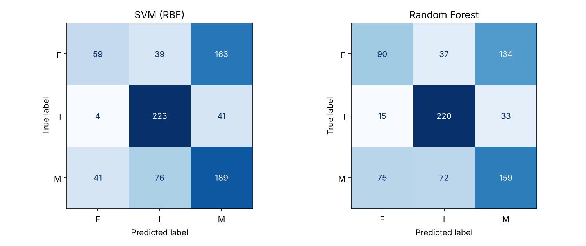

### Pembahasan

Kedua model hampir identik dalam akurasi (0,564 untuk SVM dan 0,562 untuk RF) dan jauh di atas *baseline* 0,366, tetapi kinerja absolutnya sedang saja. Dengan 835 data uji, galat baku akurasi sekitar 0,017, jadi selisih 0,002 jelas tidak bermakna secara statistik. SVM sedikit unggul pada akurasi, presisi *macro*, dan akurasi validasi silang (0,554 berbanding 0,546), sedangkan RF sedikit unggul pada *recall* dan F1 *macro* karena lebih sering berhasil mengenali kelas F. Jadi tidak ada pemenang yang tegas; kalau harus memilih, saya menilai keduanya setara pada data ini, dan perbedaan kecil di atas lebih mungkin berasal dari pembagian data tertentu daripada dari keunggulan algoritma.

Pola kesalahannya lebih informatif daripada angka akurasinya. Kelas I dikenali dengan baik oleh kedua model (*recall* sekitar 0,82–0,83), sedangkan kelas F dan M sangat sering tertukar. *Recall* kelas F pada SVM hanya 0,226: dari 261 abalone betina, 163 diprediksi jantan. Untuk memastikan hal ini, saya menjalankan dua eksperimen tambahan dengan model dan hiperparameter yang sama. Pada tugas biner *infant* lawan dewasa (F dan M digabung), akurasi kedua model naik menjadi 0,832 (presisi 0,870 dan 0,874; *recall* 0,885 dan 0,880 untuk kelas dewasa). Sebaliknya, pada tugas F lawan M saja, akurasi hanya 0,564 (SVM) dan 0,531 (RF), padahal proporsi M di antara abalone dewasa adalah sekitar 0,54. Artinya, ukuran fisik hampir tidak membedakan jantan dari betina; yang dapat dipelajari model terutama adalah perbedaan fase kehidupan (*infant* yang berukuran kecil dan dewasa yang berukuran besar). Batas kinerja sekitar 56% ini lebih bersumber dari data daripada dari pilihan algoritma.

Dari sisi kelebihan dan kekurangan, SVM dengan kernel RBF mampu membentuk batas keputusan non-linier yang halus dan bekerja baik pada fitur kontinu yang berdimensi rendah seperti ini, tetapi ia sensitif terhadap skala fitur (sehingga standarisasi wajib), membutuhkan penyetelan `C` dan `gamma`, dan tidak memberi tahu fitur mana yang penting. Karena fitur-fitur abalone sangat berkorelasi, SVM tidak bermasalah dengan multikolinearitas, tetapi sebagian besar informasinya sebenarnya hanya satu dimensi "ukuran". *Random Forest* tidak memerlukan standarisasi, tahan terhadap pencilan seperti satu pengamatan `Height = 1,13`, dan memberikan ukuran kepentingan fitur. Namun, fitur yang berkorelasi tinggi membuat kepentingan terbagi-bagi di antara mereka: `Viscera_weight` (0,223), `Shell_weight` (0,195), dan `Whole_weight` (0,192) tampil teratas, sedangkan `Length` (0,077) terendah, dan urutan ini sebaiknya tidak ditafsirkan sebagai bukti bahwa fitur tersebut lebih "menentukan" secara biologis. RF juga cenderung *overfit* bila `min_samples_leaf` kecil; hasil pencarian grid yang memilih `min_samples_leaf = 10` konsisten dengan data yang banyak noise ini.

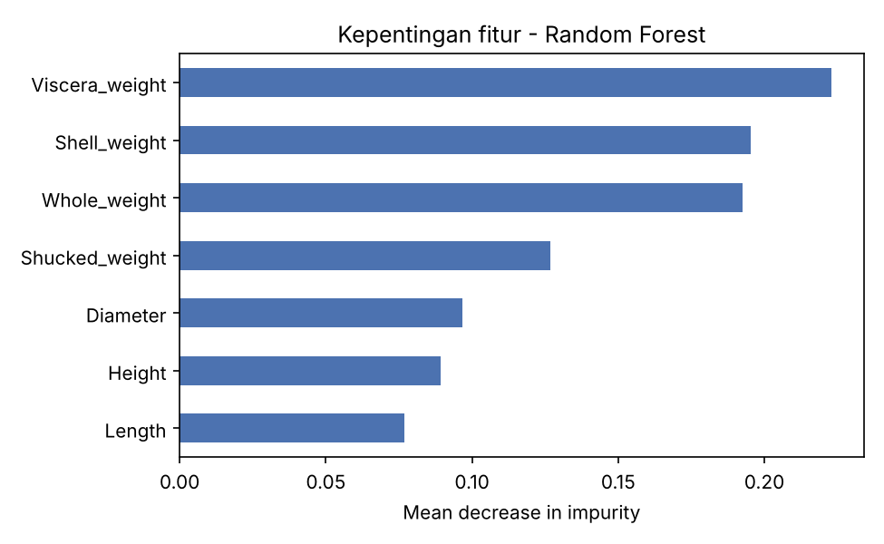

## 2. Regresi jumlah cincin

### Rancangan

Targetnya `Rings`. Empat model dibandingkan, dengan fokus pada dua model yang diminta soal:

1. Regresi linear sederhana dengan satu prediktor. Prediktor dipilih sebagai fitur dengan korelasi tertinggi terhadap `Rings` pada data latih, yaitu `Shell_weight` (r = 0,626).
2. Regresi linear berganda dengan tujuh fitur numerik terstandarisasi ditambah `Sex` yang dikodekan *one-hot* (kategori F sebagai rujukan).
3. Regresi polinomial derajat 2 dengan regularisasi Ridge (`alpha = 1000` hasil validasi silang), sebagai upaya menangkap kelengkungan.
4. *Random Forest Regressor* (300 pohon, `min_samples_leaf = 3`), sebagai model non-linier pembanding.

Evaluasi memakai *mean squared error* (MSE) pada data uji; RMSE, MAE, R², dan MSE validasi silang 5 lipatan disertakan agar tidak bergantung pada satu pembagian data.

### Hasil

| Model | MSE uji | RMSE | MAE | R² uji | MSE latih | MSE CV (5 lipatan) |
|---|---|---|---|---|---|---|
| *Baseline* (rata-rata `Rings`) | 11,41 | – | – | – | – | – |
| Regresi linear sederhana (`Shell_weight`) | 6,84 | 2,62 | 1,90 | 0,401 | 6,16 | 6,17 ± 0,50 |
| Regresi linear berganda | 4,91 | 2,22 | 1,59 | 0,570 | 4,78 | 4,97 ± 0,50 |
| Polinomial derajat 2 + Ridge | 5,90 | 2,43 | 1,71 | 0,483 | 5,27 | 5,48 ± 0,58 |
| *Random Forest Regressor* | 4,94 | 2,22 | 1,55 | 0,567 | 1,52 | 4,64 ± 0,42 |

Persamaan regresi sederhana pada skala asli adalah `Rings = 6,50 + 14,35 × Shell_weight`; setiap tambahan 1 gram bobot cangkang dikaitkan dengan sekitar 14 cincin lebih banyak, dan intersep 6,5 adalah perkiraan untuk bobot cangkang mendekati nol.

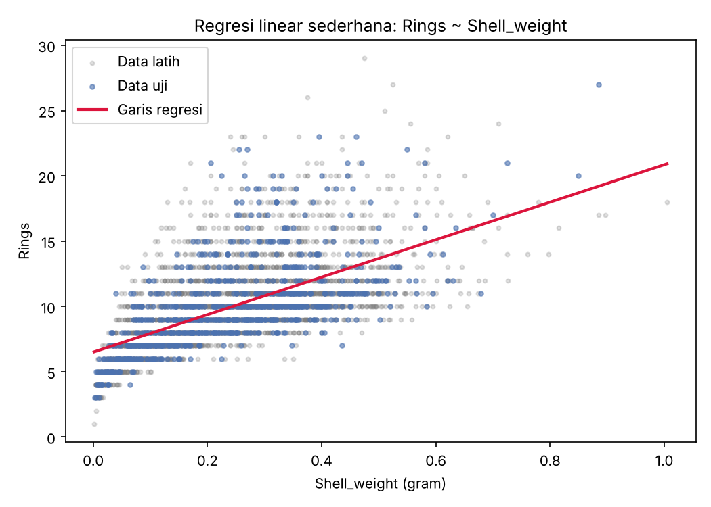

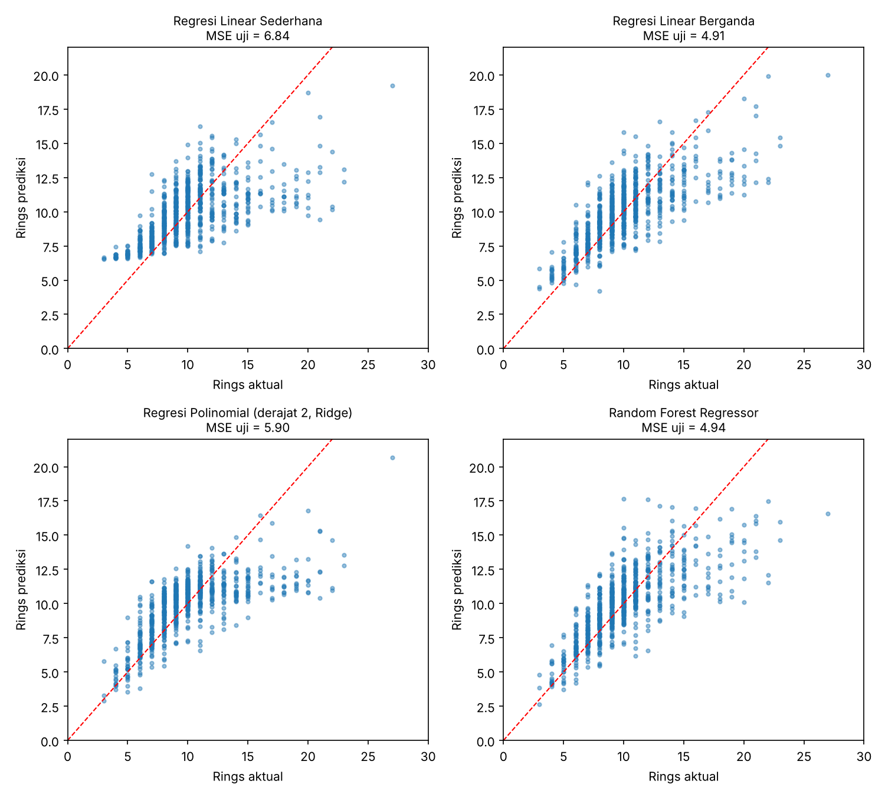

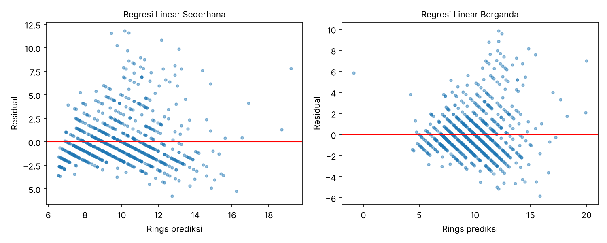

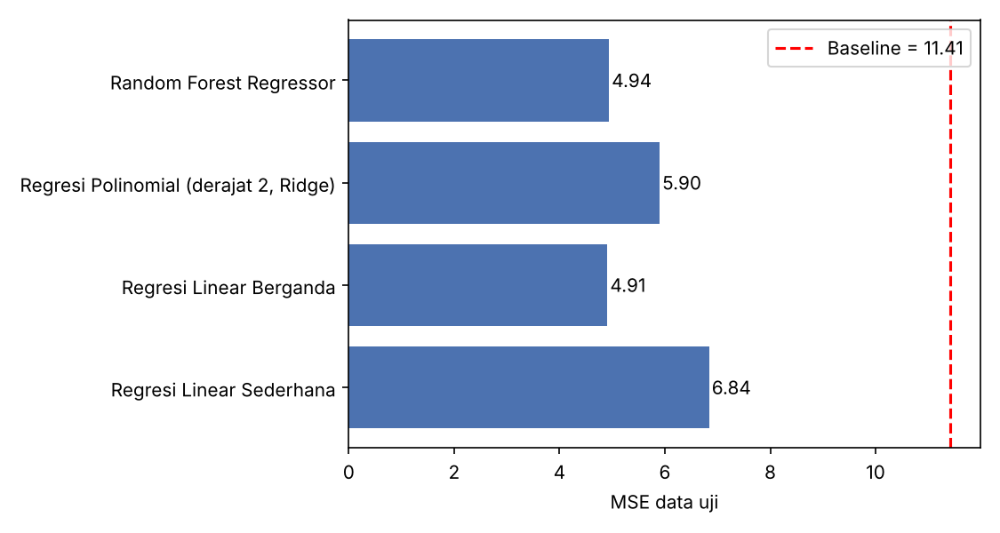

### Pembahasan

Regresi linear berganda jelas lebih baik daripada regresi sederhana: MSE uji turun dari 6,84 menjadi 4,91, dan R² naik dari 0,40 menjadi 0,57. Ketiga ukuran (MSE uji, MSE validasi silang, dan MAE) menunjukkan urutan yang sama, jadi kesimpulan ini tidak bergantung pada satu pembagian data. MSE uji regresi sederhana (6,84) agak lebih tinggi daripada MSE validasi silangnya (6,17), yang menandakan bahwa data uji kebetulan sedikit lebih sulit, bukan bahwa model *overfit* (MSE latihnya 6,16). Semua model mengalahkan *baseline* (11,41) dengan margin lebar.

Garis regresi sederhana pada plot sebar memperlihatkan keterbatasannya. Titik-titik menyebar lebar di sekitar garis, dan hubungan bobot cangkang dengan jumlah cincin melengkung: pada abalone tua, bobot cangkang terus bertambah, tetapi jumlah cincin tidak naik secepat itu. Plot residual menunjukkan dua hal. Pertama, residual tersusun dalam pita-pita diagonal, yang wajar karena `Rings` bilangan bulat sedangkan prediksinya kontinu. Kedua, sebarannya tidak simetris: residual positif besar (hingga sekitar +10 cincin) jauh lebih banyak daripada residual negatif besar, dan sebarannya melebar pada prediksi menengah ke atas. Artinya abalone yang sebenarnya tua sering diprediksi terlalu muda, sehingga asumsi ragam konstan dan residual simetris tidak terpenuhi dengan baik. Pola yang sama tampak pada regresi berganda, hanya dengan sebaran yang lebih sempit. Satu prediktor saja memang tidak cukup, karena `Shell_weight` hanya menangkap satu sisi pertumbuhan.

Pada regresi berganda, koefisien-koefisiennya memerlukan kehati-hatian. Dengan model OLS pada data latih (skala asli), `Shucked_weight` memiliki koefisien negatif besar (−18,7), `Diameter` dan `Height` positif (12,5 dan 10,4), sedangkan `Length` tidak signifikan (−1,44; p = 0,488). Tanda negatif `Shucked_weight` tidak berarti bobot daging menurunkan umur; itu efek dari multikolinearitas, karena VIF `Whole_weight` sekitar 107, `Diameter` 43, `Length` 42, dan `Shucked_weight` 27. Ketika fitur sangat berkorelasi, koefisien individualnya tidak stabil dan sulit ditafsirkan, meskipun kemampuan prediksi model secara keseluruhan tetap baik. Peubah `Sex` juga berkontribusi: abalone *infant* diperkirakan memiliki sekitar 0,75 cincin lebih sedikit daripada betina dengan ukuran yang sama (p < 0,001), sedangkan selisih jantan dan betina tidak signifikan (p = 0,272), yang sejalan dengan temuan di Bagian 1.

Model polinomial derajat 2 (MSE uji 5,90) justru lebih buruk daripada regresi berganda biasa. Penalti Ridge yang dipilih validasi silang sangat besar (`alpha = 1000`), yang berarti penambahan suku kuadrat dan interaksi pada fitur yang sudah sangat kolinier lebih banyak menambah derau daripada informasi. *Random Forest* mencapai MSE uji 4,94, praktis sama dengan regresi berganda (4,91), dan MSE validasi silangnya sedikit lebih baik (4,64 berbanding 4,97). Namun MSE latihnya hanya 1,52, jauh di bawah MSE uji, yang menunjukkan kecenderungan menghafal data latih. Jadi model non-linier tidak memberi keuntungan jelas pada data ini; sebagian besar variasi `Rings` yang bisa dijelaskan oleh ukuran fisik sudah ditangkap model linier berganda, sedangkan sisanya (R² sekitar 0,57) tampaknya berasal dari variasi biologis antarindividu dan lingkungan yang tidak terekam oleh dataset.

Secara praktis, regresi berganda adalah pilihan terbaik di antara model-model ini karena paling sederhana dengan galat terendah. Kekurangannya adalah koefisien yang sulit ditafsirkan akibat multikolinearitas serta asumsi linearitas dan ragam konstan yang tidak sepenuhnya terpenuhi. Regresi sederhana mudah dijelaskan dan divisualisasikan tetapi kehilangan banyak informasi. Satu keterbatasan yang perlu dicatat: `Rings` adalah bilangan bulat dengan sebaran miring ke kanan, sehingga transformasi logaritma pada target dapat dicoba pada pengembangan berikutnya (tidak dilakukan di sini agar MSE tetap sebanding dalam satuan cincin).

## 3. Klasterisasi

### Rancangan

Klasterisasi memakai tujuh fitur numerik yang distandarisasi; `Sex` dan `Rings` tidak dipakai sama sekali dan baru digunakan setelah klasterisasi untuk evaluasi. Tiga algoritma dijalankan untuk k = 2 sampai 10: *K-means* (`n_init = 20`), *Spectral Clustering* (afinitas graf tetangga terdekat dengan 15 tetangga) dan *Hierarchical Clustering* dengan *linkage* Ward. Pilihan 15 tetangga pada *spectral* bersifat tetap dan tidak diuji sensitivitasnya.

Jumlah klaster ditentukan dengan beberapa kriteria sekaligus: metode siku (*elbow*) pada inersia *K-means*, koefisien *silhouette*, indeks Calinski-Harabasz, indeks Davies-Bouldin, dan dendrogram Ward.

### Penentuan jumlah klaster optimal

| k | *Silhouette* K-means | *Silhouette* Spectral | *Silhouette* Ward | Davies-Bouldin K-means |
|---|---|---|---|---|
| 2 | 0,513 | 0,446 | 0,513 | 0,669 |
| 3 | 0,443 | 0,427 | 0,452 | 0,725 |
| 4 | 0,416 | 0,401 | 0,390 | 0,764 |
| 5 | 0,387 | 0,387 | 0,364 | 0,819 |

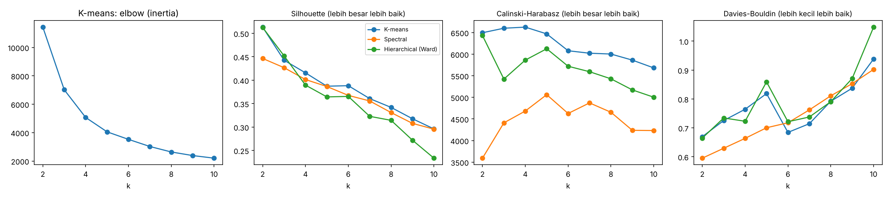

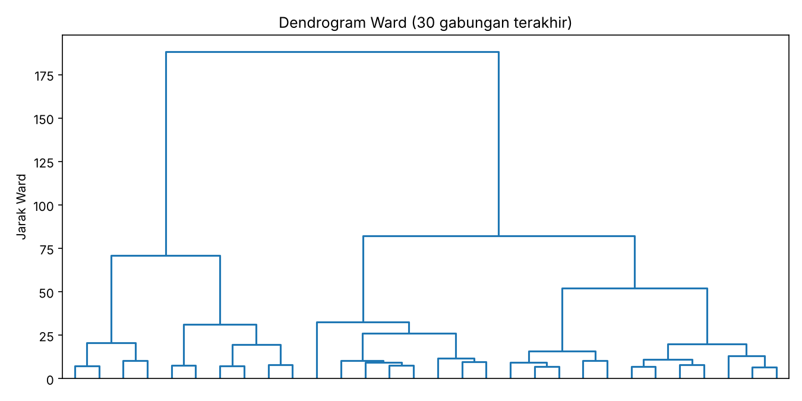

Koefisien *silhouette* tertinggi muncul pada k = 2 untuk ketiga algoritma, dan nilainya menurun secara monoton setelahnya. Indeks Davies-Bouldin juga paling baik pada k = 2 untuk K-means dan *spectral*, dan untuk Ward (0,665 pada k = 2). Pada dendrogram Ward, tinggi lima penggabungan terakhir adalah 32,6; 52,0; 70,9; 82,2 dan 188,3, sehingga lonjakan terbesar terjadi pada penggabungan terakhir, yang artinya data secara alami terpisah menjadi dua kelompok besar. Kurva inersia (11.430; 7.017; 5.068; 4.055; ...) menurun halus tanpa siku yang tegas. Indeks Calinski-Harabasz hampir datar antara k = 2 sampai 5 (sekitar 6.500–6.600 untuk K-means) dan memuncak di k = 4 dengan selisih tipis, jadi kriteria ini tidak memberikan alasan kuat untuk memilih k yang lebih besar. Berdasarkan *silhouette*, Davies-Bouldin, dan dendrogram, saya menetapkan **k = 2** sebagai jumlah klaster optimal. Saya tetap melaporkan k = 3 sebagai pembanding karena sesuai dengan tiga kategori `Sex`.

Perlu dicatat bahwa nilai *silhouette* 0,51 tidak menandakan klaster yang terpisah tegas. Karena 90,8% ragam berada pada satu komponen utama, data berbentuk satu "awan memanjang" menurut ukuran tubuh, dan pembagian menjadi dua klaster pada dasarnya memotong awan itu menjadi bagian kecil dan besar. Ini terlihat jelas pada plot PCA.

### Visualisasi klaster

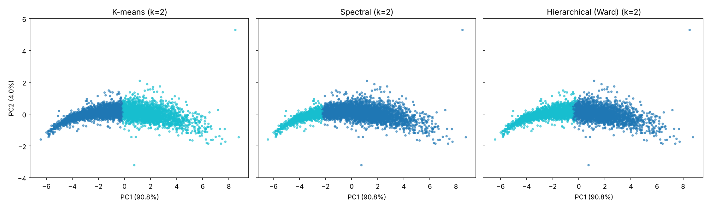

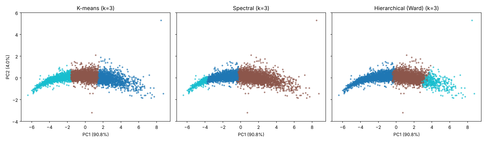

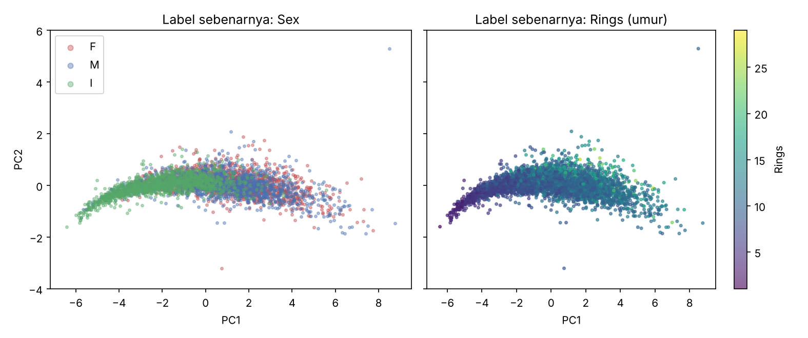

Visualisasi dilakukan pada dua komponen utama pertama (menjelaskan 90,8% dan 4,0% ragam). Satu titik pencilan (`Height` = 1,13) berada di luar rentang sumbu vertikal dan tidak tergambar.

### Perbandingan dengan label sebenarnya (k = 2)

Kategori umur dibentuk dari `Rings` menjadi Muda (≤ 8 cincin), Sedang (9–10), dan Tua (≥ 11). Batas ini dipilih agar ukuran kelompok tidak terlalu timpang, dan sifatnya sewenang-wenang. Kesesuaian diukur dengan *adjusted Rand index* (ARI) dan *normalized mutual information* (NMI).

| Algoritma | Ukuran klaster | `Rings` rata-rata | ARI vs `Sex` | ARI vs *infant*/dewasa | ARI vs umur | NMI vs umur |
|---|---|---|---|---|---|---|
| K-means | 1940 / 2235 | 8,32 / 11,34 | 0,184 | 0,269 | 0,202 | 0,181 |
| Spectral | 3324 / 851 | 10,73 / 6,85 | 0,090 | 0,289 | 0,111 | 0,179 |
| Ward | 2337 / 1838 | 11,28 / 8,22 | 0,181 | 0,282 | 0,206 | 0,185 |

Komposisi klaster yang lebih kecil/muda: pada K-means, klaster 0 (1940 abalone) terdiri atas 1138 *infant*, 334 betina, dan 468 jantan, dengan 1186 abalone muda. Pada Ward, klaster 1 (1838 abalone) berisi 1101 *infant* dan 1159 abalone muda. Pada *spectral*, klaster kecil (851 abalone) berisi 643 *infant* (76%) dan 710 abalone muda (83%).

### Pembahasan

Tidak satu pun algoritma menghasilkan klaster yang selaras dengan `Sex` (ARI maksimum 0,184). Ini konsisten dengan Bagian 1: jantan dan betina tidak dapat dibedakan lewat ukuran, sehingga pada semua klaster keduanya bercampur dengan proporsi yang kira-kira sama. Yang tertangkap adalah pemisahan *infant* dari dewasa dan, searah dengan itu, pemisahan abalone muda dari tua. ARI terhadap kategori *infant*/dewasa (0,27–0,29) lebih tinggi daripada terhadap `Sex` tiga kelas, dan klaster kecil memiliki rata-rata `Rings` yang jauh lebih rendah. Meskipun demikian, kesesuaian ini tergolong lemah: ARI di bawah 0,3 berarti banyak abalone dewasa muda ada di klaster "kecil" dan sebaliknya, dan sebuah klaster yang 59% berisi *infant* masih menyisakan 41% non-*infant*. Pada k = 3, K-means menghasilkan klaster paling kecil (1163 abalone, rata-rata 7,33 cincin) yang 71% adalah *infant* dan 77% muda, sedangkan *spectral* menghasilkan klaster sangat kecil (301 abalone, rata-rata 5,51 cincin) yang sebagian besarnya *infant* (82%) dan muda (96%), tetapi hanya menangkap sebagian kecil dari seluruh *infant*. Tidak ada klaster dengan nilai `Sex` yang murni.

K-means dan Ward menghasilkan pembagian yang hampir sama pada k = 2 (nilai *silhouette* sama 0,513, ARI-nya terhadap label hampir kembar), karena keduanya meminimalkan ragam dalam klaster dan menghasilkan klaster berbentuk cembung dan berukuran seimbang; dengan data berupa satu awan memanjang, pembatas keduanya adalah "potongan melintang" pada sumbu ukuran. *Spectral clustering* dengan graf tetangga terdekat bekerja berdasarkan konektivitas lokal, sehingga ia cenderung memotong ujung awan yang kepadatannya rendah dan menghasilkan klaster yang tidak seimbang (851 lawan 3324). Pola itu menarik karena klaster kecilnya memang yang paling murni secara biologis (abalone paling muda), tetapi nilai *silhouette* dan Calinski-Harabasz-nya lebih rendah karena kedua ukuran itu menyukai klaster kompak dan cembung.

Algoritma mana yang paling sesuai bergantung pada tujuan. Berdasarkan ukuran validasi internal dan kemudahan, K-means atau Ward lebih cocok untuk struktur data ini: kedua algoritma cepat dan stabil, dan hasilnya konsisten satu sama lain. Ward punya keuntungan memberikan dendrogram yang secara visual mendukung pilihan k = 2, sedangkan K-means lebih murah secara komputasi untuk data yang lebih besar. Spectral clustering unggul jika klaster berbentuk tidak cembung atau berbeda kepadatan, tetapi data abalone tidak memperlihatkan struktur seperti itu (tidak ada celah yang jelas antar kelompok), sehingga keunggulannya tidak banyak terpakai dan komputasinya lebih mahal (membutuhkan matriks afinitas dan dekomposisi eigen). Kesimpulan yang lebih penting adalah bahwa data ini lebih tepat dipandang sebagai kontinum pertumbuhan daripada sebagai kelompok-kelompok diskret, sehingga klaster apa pun yang didapat sebaiknya dibaca sebagai "ukuran kecil, sedang, besar", bukan sebagai kategori alami.

## 4. Keterbatasan

Seluruh hasil berasal dari satu pembagian data latih dan uji (disertai validasi silang pada Bagian 1 dan 2), sehingga selisih kecil antarmodel, seperti SVM dan RF pada Bagian 1, tidak boleh ditafsirkan sebagai keunggulan. Multikolinearitas yang tinggi membatasi penafsiran koefisien dan kepentingan fitur. Pilihan batas kategori umur, jumlah tetangga pada *spectral clustering*, dan pembuangan hanya dua baris `Height = 0` adalah keputusan analis yang dapat memengaruhi angka secara kecil. Uji sensitivitas terhadap keputusan-keputusan tersebut tidak dilakukan.

## Rujukan

Nash, W., Sellers, T., Talbot, S., Cawthorn, A., & Ford, W. (1994). *Abalone* [Dataset]. UCI Machine Learning Repository. https://archive.ics.uci.edu/dataset/1/abalone

Pedregosa, F., dkk. (2011). Scikit-learn: Machine learning in Python. *Journal of Machine Learning Research, 12*, 2825–2830.
